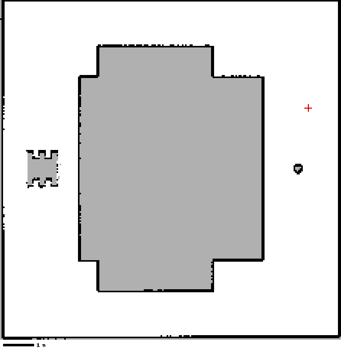

# br_sim — Robocon 四舵轮机器人 Gazebo 仿真：SLAM 建图 + Nav2 自主导航

> **环境**：Ubuntu 22.04 + ROS 2 Humble + Gazebo Classic 11 + slam_toolbox 2.6 + Nav2 1.1
> **验证**：Nav2 两个跨区域目标全部 `SUCCEEDED`，AMCL 定位误差 ≈2 cm（见[第十节](#十实测验证数据)）

<p align="center">
  
  <br>
  <i>机器人建出的地图（11.15 × 11.10 m，0.05 m/格；黑=墙，白=可通行，灰=未探索区域，红十字=出生点）</i>
</p>
复刻跳一跳→<a href='#环境配置'>第三节</a> <a href='#获取与编译'>第四节</a>


---

## 一、项目简介

这是 **Robocon 四舵轮（4 舵轮 + 全向底盘）机器人**的 Gazebo 仿真包，目标是
**在仿真里完整跑通「建图 → 定位 → 自主导航」**，用来验证算法与参数。

- **仿真环境**：比赛场地（11 m × 11 m 围墙 + 6 m × 6 m 中心平台 + 斜坡 + 圆柱障碍），
  Gazebo Classic 11 + ODE 物理引擎。
  
- **机器人模型**：真实 STL 网格（车体、4 组舵轮、MID360 雷达外形），
  `planar_move` 全向运动学底盘 ， `cmd_vel` 的 `vx / vy / wz` 都生效（真全向，可横移）。
  
- **传感器**：MID360 模拟（360 线激光 → `/scan`）、`/imu`、`/odom` + TF。

- **SLAM**：`slam_toolbox` online async 建图，RViz 实时看地图；`map_saver_cli` 一键存图。

- **导航**：Nav2（AMCL + NavFn 全局规划 + DWB 全向控制 + 行为树恢复），
  支持 RViz 点 `Nav2 Goal`，也支持脚本 / 命令行发目标，使用Nav2官方二进制包，方便拉取使用。
  
  （其实是之前的导航蹭墙修复不好换了）
  
- **自带地图**：`src/br_sim/maps/robocon_map.pgm` —— 全场地巡视过、围墙闭合、四角连通
  （`check_map.py` 可随时复验），**不开建图也能直接导航**。

- **不含实车驱动**：话题为 ROS 2 标准接口。

## 二、仓库内容

### 目录结构

```
sim_nav_ws/                         ← colcon 工作空间根目录
├── README.md                       ← 本文档
├── .gitignore                      ← 忽略 build/ install/ log/
└── src/
    └── br_sim/                     ← 唯一的 ROS 2 包
        ├── CMakeLists.txt          ← 安装 urdf/worlds/launch/config/maps + 3 个脚本
        ├── package.xml             ← 依赖声明（gazebo_ros / nav2_bringup / slam_toolbox …）
        ├── launch/
        │   ├── sim.launch.py       ← ① Gazebo + 场地 + 机器人 + 传感器
        │   ├── slam.launch.py      ← ② slam_toolbox 建图 + RViz
        │   └── navigation.launch.py← ③ Nav2 导航 + RViz
        ├── urdf/
        │   ├── br.urdf             ← 机器人模型：几何 / 关节 / 碰撞 / 传感器插件
        │   ├── model.config        ← Gazebo 模型描述（urdf 整个目录可被当 model 加载）
        │   └── meshes/             ← 19 个 STL（车体 22 MB、轮组、MID360 外形）
        ├── worlds/
        │   ├── robocon.world       ← 场地场景（物理参数、太阳光、包含 ground 模型）
        │   └── robocon_ground/     ← 场地模型：model.sdf（围墙/平台/斜坡/圆柱）
        │       ├── README.txt      ← 模型来源与网格说明
        │       ├── model.config
        │       ├── model.sdf
        │       └── meshes/Untitled.dae
        ├── config/
        │   ├── mapper_params_online_async.yaml  ← SLAM 参数
        │   ├── nav2_params.yaml                 ← Nav2 全套参数（AMCL/规划/控制/代价地图/BT）
        │   └── rviz/
        │       ├── slam.rviz       ← 建图 RViz 布局
        │       └── nav.rviz        ← 导航 RViz 布局（含 Nav2 面板）
        ├── maps/
        │   ├── robocon_map.pgm     ← 已建好的地图（223 × 222，49 KB）
        │   ├── robocon_map.yaml    ← 地图元信息（res 0.05、origin [-5.56,-5.57,0]）
        │   └── robocon_map_preview.png ← README 可视化预览
        └── scripts/
            ├── test_nav.py            ← Nav2 端到端验证（发初始位姿 + 两个目标）
            ├── check_map.py           ← 地图自检（围墙闭合 / 走廊可达 / 像素统计）
            └── make_map_preview.py    ← 由 pgm 生成 PNG 预览（需 python3-pil）
```

### 可修改参数

| 可修改 |  |
|------------|------|
| 机器人外形 / 加传感器 / 换雷达 | `urdf/br.urdf`（+ `urdf/meshes/`） |
| 场地布局（围墙、平台、斜坡、障碍） | `worlds/robocon_ground/model.sdf` |
| 物理引擎 / 重力 / 光照 | `worlds/robocon.world` |
| 出生点 / 姿态 | `launch/sim.launch.py` 的 `-x -y -z -Y` |
| 速度上限、目标容差、footprint、膨胀 | `config/nav2_params.yaml` |
| BT 插件清单 | `config/nav2_params.yaml` → `plugin_lib_names` |
| 建图分辨率 / 雷达量程 / 更新频率 | `config/mapper_params_online_async.yaml` |
| **新增/替换地图文件** | `maps/*.pgm` + `*.yaml` |
| 新增脚本 | `scripts/` + `CMakeLists.txt` 的 `install(PROGRAMS …)` |

> `install/` 里的 `urdf/ worlds/ launch/ config/` 都是**软链接**到 `src/`，所以改 URDF / yaml / launch 立即生效，不用重编译。但 colcon **不会为空目录预建软链**，所以「目录里新出现的文件类型/新目录」必须再 build 一次。

### 话题与坐标系

| 话题 | 类型 | 说明 |
|------|------|------|
| `/scan` | `sensor_msgs/LaserScan` | MID360 模拟激光，360 线，0.15 ~ 40 m |
| `/imu` | `sensor_msgs/Imu` | 车身 IMU |
| `/odom` | `nav_msgs/Odometry` | `planar_move` 直接给真值位姿（含 `odom→base_link` TF） |
| `/cmd_vel` | `geometry_msgs/Twist` | `vx / vy / wz`（全向） |
| `/map` | `nav_msgs/OccupancyGrid` | SLAM 或 AMCL 的地图 |
| `/initialpose` | `PoseWithCovarianceStamped` | 给 AMCL 初始位姿 |
| `/amcl_pose` | `PoseWithCovarianceStamped` | AMCL 定位结果 |
| `navigate_to_pose` | `nav2_msgs/NavigateToPose`（action） | Nav2 目标接口 |

---

## 三、环境配置

> 本节假设你手上是一台**刚装好的 Ubuntu 22.04，没有任何 ROS**。按顺序执行即可。
> 若你的机器已经装好 ROS 2 Humble，可直接跳到 [3.3](#33-安装本项目依赖仿真--导航-apt-包)。

### 3.1 系统要求

| 项目 | 要求 | 说明 |
|------|------|------|
| 操作系统 | **Ubuntu 22.04 LTS (Jammy)** x86_64 | 与 ROS 2 Humble 二进制包对应 |
| ROS 2 | **Humble Hawksbill** | 本包按 Humble 的 API / launch 写法 |
| 仿真器 | **Gazebo Classic 11**（`gzserver` 11.10.x） | 不是 Ignition / gz-sim |
| 显示 | 需要 OpenGL（可用软件渲染） | 无独显 / Wayland / WSL / 容器见 [§11](#启动--显示) |

本仓库实测通过的版本组合：

```
ros-humble-desktop        0.10.0
gazebo (Classic)          11.10.2
ros-humble-gazebo-ros-pkgs 3.9.0
ros-humble-navigation2 / nav2-bringup 1.1.20
ros-humble-slam-toolbox   2.6.10
ros-humble-rviz2          11.2.29
```

### 3.2 安装 ROS 2 Humble

```bash
# 1) 语言环境（UTF-8，否则 ros2 命令行会报 locale 警告）
sudo apt update && sudo apt install -y locales
sudo locale-gen en_US en_US.UTF-8
sudo update-locale LC_ALL=en_US.UTF-8 LANG=en_US.UTF-8
export LANG=en_US.UTF-8

# 2) 启用 universe 源并准备工具
sudo apt install -y software-properties-common curl
sudo add-apt-repository universe

# 3) 添加 ROS 2 apt 仓库（ROS 官方 key + 源）
sudo curl -sSL https://raw.githubusercontent.com/ros/rosdistro/master/ros.key \
  -o /usr/share/keyrings/ros-archive-keyring.gpg
echo "deb [arch=$(dpkg --print-architecture) signed-by=/usr/share/keyrings/ros-archive-keyring.gpg] \
http://packages.ros.org/ros2/ubuntu $(. /etc/os-release && echo $UBUNTU_CODENAME) main" \
  | sudo tee /etc/apt/sources.list.d/ros2.list > /dev/null

# 4) 安装 ROS 2 Humble 桌面版（含 rviz2、rqt 等）
sudo apt update && sudo apt upgrade -y
sudo apt install -y ros-humble-desktop
```

### 3.3 安装本项目依赖（仿真 + 导航 apt 包）

```bash
sudo apt install -y \
  ros-humble-gazebo-ros-pkgs \
  ros-humble-navigation2 ros-humble-nav2-bringup \
  ros-humble-slam-toolbox \
  ros-humble-teleop-twist-keyboard \
  python3-colcon-common-extensions python3-yaml python3-pil
```

各包作用：

| 包 | 作用 |
|----|------|
| `ros-humble-gazebo-ros-pkgs` | Gazebo Classic 桥接（`/clock`、`/spawn_entity`、传感器插件），会带上 Gazebo 11 |
| `ros-humble-navigation2` + `nav2-bringup` | Nav2 导航栈（AMCL、规划器、控制器、行为树） |
| `ros-humble-slam-toolbox` | 建图 / 定位 |
| `ros-humble-teleop-twist-keyboard` | 键盘遥控（建图时巡视场地用） |
| `python3-colcon-common-extensions` | `colcon build` |
| `python3-yaml`、`python3-pil` | `check_map.py` / `make_map_preview.py` 用 |

> 如果 `apt` 报 **`gazebo11` 找不到**，说明系统源里没有 Gazebo Classic，加 OSRF 源后再装：
>
> ```bash
> sudo curl -sSL https://packages.osrfoundation.org/gazebo.gpg \
>   -o /usr/share/keyrings/pkgs-osrf-archive-keyring.gpg
> echo "deb [arch=$(dpkg --print-architecture) signed-by=/usr/share/keyrings/pkgs-osrf-archive-keyring.gpg] \
> http://packages.osrfoundation.org/gazebo/ubuntu-stable $(lsb_release -cs) main" \
>   | sudo tee /etc/apt/sources.list.d/gazebo-stable.list > /dev/null
> sudo apt update && sudo apt install -y gazebo11
> ```

### 3.4 环境变量

```bash
echo "source /opt/ros/humble/setup.bash" >> ~/.bashrc
# 编译完（第四节）之后再加这一行：
echo "source ~/sim_nav_ws/install/setup.bash" >> ~/.bashrc
source ~/.bashrc
```

### 3.5 安装自检（5 条命令）

| 命令 | 期望输出 |
|------|----------|
| `printenv ROS_DISTRO` | `humble` |
| `ros2 pkg prefix gazebo_ros` | `/opt/ros/humble` |
| `ros2 pkg prefix nav2_bringup` | `/opt/ros/humble` |
| `ros2 pkg prefix slam_toolbox` | `/opt/ros/humble` |
| `gzserver --version` | `Gazebo multi-robot simulator, version 11.10.x` |


## 四、获取与编译

```bash
# 1) 克隆（仓库根目录 = 工作空间根目录，clone 完就能直接编译）
cd ~
git clone https://github.com/yuyue8725-sys/br_sim.git sim_nav_ws
cd ~/sim_nav_ws            # 里面 src/br_sim 就是唯一的包

# 2) （可选）自动检查依赖；apt 都装好了会直接跳过
rosdep install --from-paths src --ignore-src -r -y

# 3) 编译
colcon build --symlink-install

# 4) 生效
source install/setup.bash
```

期望看到：

```
Starting >>> br_sim
Finished <<< br_sim [0.5s]
Summary: 1 package finished [1.0s]
```

验证：

```bash
ros2 pkg prefix br_sim       # → /home/<你>/sim_nav_ws/install/br_sim
ros2 pkg executables br_sim  # → 3 个脚本：check_map.py  make_map_preview.py  test_nav.py
```

---

## 五、快速开始（4 个终端跑完全流程）

**终端 1 —— 仿真（Gazebo + 机器人）**

```bash
source /opt/ros/humble/setup.bash
source ~/sim_nav_ws/install/setup.bash
ros2 launch br_sim sim.launch.py
```

**终端 2 —— 导航（Nav2 + RViz）**（等终端 1 出现 `Spawn status: SpawnEntity` 后再启动）

```bash
source /opt/ros/humble/setup.bash
source ~/sim_nav_ws/install/setup.bash
ros2 launch br_sim navigation.launch.py
```

**终端 3 —— 直接发目标（不想用 RViz 点击时）**

```bash
source /opt/ros/humble/setup.bash
source ~/sim_nav_ws/install/setup.bash
ros2 run br_sim test_nav.py 
```

期望输出（本机实测；数值每次略有差异，误差都在 `xy_goal_tolerance=0.25` m 附近）：

```
机器人当前位姿(世界): x=4.78 y=1.62 yaw=-1.57
-> 发布 /initialpose = (4.78, 1.62, yaw=-1.57)
   AMCL 输出位姿: (4.77, 1.63, yaw=-1.58)  cov_xy=(0.412, 0.471)
-> 导航目标 (0.50, 4.60, yaw=0.00)
   结束状态=4  实际到位 (0.73, 4.80, yaw=-0.22)  误差=0.30 m
-> 导航目标 (-4.50, 1.30, yaw=1.57)
   结束状态=4  实际到位 (-4.45, 1.57, yaw=1.32)  误差=0.27 m
```

`结束状态=4` = `STATUS_SUCCEEDED`。脚本发完 `/initialpose` 后会先让底盘原地转 1.5 s 再读 `/amcl_pose`：
**AMCL 只在滤波器更新（位姿有变化）时才发布这个话题**，机器人静止时一条都不发
（实测静止 12 s 收到 0 条、旋转时约 2 Hz）。所以若仍看到 `警告: 没收到 /amcl_pose`，
只说明这次没等到更新，导航完全不受影响，继续看后面的 `结束状态` 即可。

**终端 4（可选）*

```bash
ros2 launch br_sim slam.launch.py           
ros2 run teleop_twist_keyboard teleop_twist_keyboard
```

> 建图时把机器人开遍四条走廊和四个角，地图就完整了。键位：
> `i` 前进 / `,` 后退 / `j` 左移 / `l` 右移（全向底盘可横移）/ `u` 左转 / `o` 右转 / `k` 停 / `q` `z` 调速。

---

## 六、分步运行详解

### 步骤 1：启动仿真（Gazebo + 场地 + 机器人 + 传感器）

```bash
source /opt/ros/humble/setup.bash
source ~/sim_nav_ws/install/setup.bash
ros2 launch br_sim sim.launch.py
```

启动后应看到：

- Gazebo 窗口里出现比赛场地，机器人在 **(4.5, 2.0)**（右侧走廊）直立
- 控制台先起 `robot_state_publisher`，**5 秒后**才 spawn 机器人（`TimerAction(period=5.0)`，等 Gazebo 就绪）
- 关键日志：`Spawn status: SpawnEntity`、`/clock` 开始发布

验证（另开终端）：

```bash
ros2 topic list | grep -E 'scan|odom|imu|clock'
ros2 topic hz /scan      # 期望 ≈10 Hz
ros2 topic hz /odom      # 期望 ≈50 Hz
ros2 topic echo /scan --once | head -5
gz model -m br -p        # Gazebo 真值位姿：z 应稳定 ≈0.054，roll/pitch≈0
```

模型内部做了什么（改模型前必读）：

- `sim.launch.py` 把 URDF 里的 `package://br_sim` 全局替换成 `file://<install路径>`，
  因为 **Gazebo Classic 11 的 mesh URI 处理器不支持 `package://`**（静默失败，mesh 不渲染）
- spawn 用 `-topic robot_description` 而不是 `-file`，保证 Gazebo 拿到替换后的 URDF

### 步骤 2：SLAM 建图（另开终端）

```bash
source ~/sim_nav_ws/install/setup.bash
ros2 launch br_sim slam.launch.py
```

RViz 的 Fixed Frame 选 `map`，打开 `Map` 与 `LaserScan` 显示。然后用键盘遥控遍历场地：

```bash
ros2 run teleop_twist_keyboard teleop_twist_keyboard
```

> 全向底盘可前后左右平移 + 旋转，贴着四条走廊走一圈、把四个角都扫到，地图就完整了。
> 想省事可以直接用自带的 `maps/robocon_map.pgm`，跳过步骤 2、3。

### 步骤 3：保存地图（另开终端）

```bash
source ~/sim_nav_ws/install/setup.bash
cd ~/sim_nav_ws/src/br_sim/maps
ros2 run nav2_map_server map_saver_cli -f robocon_map
```

生成 `robocon_map.yaml` + `robocon_map.pgm`。**存到 `src/` 里**（不要存到 `install/`，
那里是软链目录，重新 build 会被覆盖/丢失）。

> ⚠️地图是**新文件**时必须重新装一遍包，否则 `install/br_sim/share/br_sim/maps/` 里没有软链
> （第一次 `colcon build` 时 maps 目录还是空的，colcon 不会为空目录预建软链）：
>
> ```bash
> cd ~/sim_nav_ws && colcon build --symlink-install --packages-select br_sim
> ```
>
> `navigation.launch.py` 默认读 `install/br_sim/share/br_sim/maps/robocon_map.yaml`，
> 缺软链就会报 "map file not found"。

存完强烈建议跑一次自检：

```bash
ros2 run br_sim check_map.py
```

### 步骤 4：自主导航（关掉建图，另开终端）

```bash
source ~/sim_nav_ws/install/setup.bash
ros2 launch br_sim navigation.launch.py
```

在 RViz 中：

1. 工具栏 **2D Pose Estimate** → 在机器人位置点一下并拖出朝向（触发 AMCL 重定位）
2. 工具栏 **Nav2 Goal** → 点目标点并拖出目标朝向 → 机器人自主规划并导航
3. 观察：全局/局部代价地图、规划路径（绿色）、粒子云（Particle Cloud）

命令行等价做法（不想用鼠标时）：

```bash
# 给初始位姿（与 sim.launch.py 的出生点一致）
ros2 topic pub --once /initialpose geometry_msgs/msg/PoseWithCovarianceStamped \
  "{header: {frame_id: map}, pose: {pose: {position: {x: 4.5, y: 2.0}, orientation: {z: 0.0, w: 1.0}}, covariance: [0.25,0,0,0,0,0, 0,0.25,0,0,0,0, 0,0,0,0,0,0, 0,0,0,0,0,0, 0,0,0,0,0,0, 0,0,0,0,0,0.0685]}}"

# 发一个目标（坐标系 map）
ros2 action send_goal /navigate_to_pose nav2_msgs/action/NavigateToPose \
  "{pose: {header: {frame_id: map}, pose: {position: {x: 0.5, y: 4.6}, orientation: {z: 0.0, w: 1.0}}}}" --feedback
```

> ⚠️ **初始位姿要尽快给**。AMCL 没收到初始位姿就不会发布 `map→odom`，
> `planner_server` 的 `global_costmap` 会一直等这个 TF，导致整个 Nav2 停在
> `Activating planner_server` 不动（日志刷 `Timed out waiting for transform from base_link to map`）。
> 这不是崩溃：在 RViz 里点一下 2D Pose Estimate，`map→odom` 一出来，其余节点会在 1~2 s 内自动激活。

### 步骤 5（可选）：自动化验收

```bash
ros2 run br_sim test_nav.py
```

它会自己读 `/odom` 当前位姿 → 发 `/initialpose` → 等 AMCL 收敛 → 依次发两个
`NavigateToPose`（`(0.5, 4.6, yaw=0)` 与 `(-4.5, 1.3, yaw=1.57)`，后者需绕中心平台）→
打印结束状态与到位误差。任一目标失败即停止后续测试。

### 停止所有进程

```bash
pkill -9 -f 'navigation.launch.py'
pkill -9 -f 'nav2_container|component_container_isolated'
pkill -9 -f 'sim.launch.py'
pkill -9 -f gzserver; pkill -9 -f gzclient; pkill -9 -f rviz2
```

> `ros2 launch` 的 Ctrl+C 偶尔会留下孤儿子进程（`pkill -f 'ros2 launch'` 杀不干净），
> 所以按**进程名**分别杀。

---

## 七、数据流与 TF 树

```
MID360(ray 传感器) → /scan ──┬──▶ slam_toolbox / AMCL → map → odom TF
IMU                → /imu    │
planar_move(全向)  → /odom + odom → base_link TF
                             └──▶ Nav2 costmap → /cmd_vel(vx, vy, wz) → planar_move
```

TF 树：

```
map ──▶ odom ──▶ base_link ──▶ mid360_link（激光雷达）
   ▲        ▲
   │        └── planar_move 插件发布（真值位姿）
   └── slam_toolbox（建图）或 AMCL（定位）发布
```

要点：

- `/odom` 是**真值**（Gazebo 世界位姿），所以本仿真里 AMCL 很容易收敛到 2 cm；
  换成实车后 `odom` 会有漂移，AMCL 参数（`alpha*`、粒子数）需要重调。
- 地图 `map` 系原点与 Gazebo 世界系对齐（`origin: [-5.56, -5.57, 0]`），
  因此**世界坐标可以直接当 map 坐标用**（`test_nav.py` 就是这么干的）。

---

## 八、参数修改指南

> 下表全是**本仓库当前值**（可直接 `grep` 核对）。改完 `nav2_params.yaml` /
> `mapper_params_online_async.yaml` / `br.urdf` **不需要重新编译**，下次 `ros2 launch` 生效。

### 8.1 运动与速度（`config/nav2_params.yaml`）

| 参数（完整路径） | 当前值 | 作用 | 调整建议 |
|------------------|--------|------|----------|
| `controller_server.FollowPath.max_vel_x` | `0.3` | 前进最大速度 m/s | 0.1 ~ 0.5；改大要同步改 `velocity_smoother` |
| `controller_server.FollowPath.min_vel_x` | `-0.3` | 后退最大速度（负值） | 同上 |
| `controller_server.FollowPath.max_vel_y` / `min_vel_y` | `0.3` / `-0.3` | **横移**速度（全向底盘） | 想把车退化成差速：都设为 `0.0` |
| `controller_server.FollowPath.max_vel_theta` | `1.0` | 最大角速度 rad/s | 0.3 ~ 1.5 |
| `controller_server.FollowPath.acc_lim_x` / `_y` / `_theta` | `2.5` / `2.5` / `3.2` | 加速度上限（负值另有 `decel_lim_*`） | 仿真相机够用；实车要按电机改小 |
| `velocity_smoother.max_velocity` | `[0.3, 0.3, 1.0]` | 平滑器输出上限 `[vx, vy, w]` | **必须 ≤ 上面三个上限**，否则以它为准 |
| `velocity_smoother.min_velocity` | `[-0.3, -0.3, -1.0]` | 反向上限 | 同上 |

### 8.2 到位精度与判定

| 参数 | 当前值 | 说明 |
|------|--------|------|
| `controller_server.FollowPath.xy_goal_tolerance` | `0.25` m | 距目标 0.25 m 内算到位（这也是实测误差 0.22~0.34 m 的原因）。想更准改 `0.10`，但可能因反复微调超时 |
| `controller_server.FollowPath.yaw_goal_tolerance` | `0.25` rad | 朝向容差 |
| `controller_server.FollowPath.trans_stopped_velocity` | `0.25` m/s | 判定「已停住」的速度阈值 |
| `controller_server.failure_tolerance` | `0.3` s | 控制周期超时容忍 |
| `planner_server.GridBased.tolerance` | `0.5` m | 全局路径终点允许偏离目标 0.5 m，建议与 `xy_goal_tolerance` 同量级 |

### 8.3 代价地图与避障

| 参数 | 当前值 | 说明 |
|------|--------|------|
| `local_costmap.local_costmap.ros__parameters.footprint` | `[[0.33,0.37],[0.33,-0.37],[-0.33,-0.37],[-0.33,0.37]]` | 机器人外廓 0.66 × 0.74 m（由 URDF 各 mesh 包围盒求并集得 0.640 × 0.685，留 1 cm 余量）。**车变胖变瘦先改这里** |
| `…inflation_radius` | `0.55` m | 障碍膨胀半径。太大挤不进走廊，太小贴墙擦碰 |
| `…cost_scaling_factor` | `3.0` | 代价值衰减系数，越大越「不敢靠近障碍」 |
| `local_costmap.…width` / `height` | `3` m | 局部代价地图边长；越大越吃 CPU |
| `local_costmap.…update_frequency` / `publish_frequency` | `5.0` / `2.0` Hz | 局部地图刷新率 |
| `global_costmap.…resolution` | `0.05` m | 全局代价地图分辨率（与地图一致最省事） |
| `global_costmap.…update_frequency` | `1.0` Hz | 全局地图刷新率 |

### 8.4 定位与规划

| 参数 | 当前值 | 说明 |
|------|--------|------|
| `amcl.robot_model_type` | `nav2_amcl::OmniMotionModel` | 全向运动模型；改差速用 `DifferentialMotionModel` |
| `amcl.max_particles` / `min_particles` | `2000` / `500` | 粒子数；实车定位抖动大时加大 |
| `amcl.laser_max_range` | `100.0` m | 应 ≥ 激光真实量程（本仿真 40 m） |
| `amcl.do_beamskip` | `false` | 长走廊里出现「跳变」时可设 `true` |
| `amcl.transform_tolerance` | `1.0` s | TF 容忍时间 |
| `planner_server.GridBased.allow_unknown` | `true` | 允许规划进未知区。地图有空洞时设 `false` 更保守（可能规划失败） |
| `bt_navigator.plugin_lib_names` | 47 项（官方清单） | **不要随意删**，缺一项 bringup 直接中止，见[第十三节](#十三修复记录二nav2-目标全被拒绝) |

### 8.5 建图（`config/mapper_params_online_async.yaml`）

| 参数 | 当前值 | 说明 |
|------|--------|------|
| `resolution` | `0.05` m | 地图分辨率；`0.03` 更精细但文件更大、更吃 CPU |
| `max_laser_range` | `20.0` m | 建图使用的最大量程（场地 11 m，足够） |
| `map_update_interval` | `2.0` s | RViz 里地图刷新间隔 |
| `minimum_time_interval` | `0.5` s | 两次处理 scan 的最小间隔（10 Hz 雷达会丢一半，属正常） |
| `mode` | `mapping` | 改成 `localization` 就是纯定位（不用 AMCL） |
| `solver_plugin` | `CeresSolver` | 后端优化器 |

### 8.6 传感器与模型（`urdf/br.urdf`）

| 位置 | 当前值 | 说明 |
|------|--------|------|
| `<gazebo>` 里 MID360 的 `<ray>` → `<samples>` | `360` | 单圈线数，越小越省 CPU（如 180） |
| `<min>` / `<max>` | `0.15` / `40.0` m | 量程 |
| `<update_rate>` | `10` Hz | 激光频率 |
| `planar_move` 插件 | — | 全向运动学底盘（`vx/vy/wz`），**不属于 Nav2 参数** |
| 关节类型 | 9 个原活动关节已改 `fixed` | 见[第十二节](#十二修复记录一能平移不能旋转)，随意改回 `revolute` 会翻车 |

### 8.7 场地与出生点

| 想改 | 位置 |
|------|------|
| 围墙 / 平台 / 斜坡 / 圆柱尺寸 | `worlds/robocon_ground/model.sdf` |
| 重力、物理步长、太阳光 | `worlds/robocon.world` |
| 机器人出生位姿 | `launch/sim.launch.py` 的 `-x -y -z -Y` |

> ⚠️ 改出生点前先确认该处**没有障碍物**：出生点与场地几何重叠会导致 ODE 生成不出接触点，
> 机器人直接穿地无限下坠。

### 8.8 改完怎么验证

```bash
ros2 param get /controller_server FollowPath.max_vel_x       # 参数是否生效
ros2 param get /local_costmap/local_costmap inflation_radius
ros2 run br_sim test_nav.py                                  # 跑一遍端到端，看误差
```

三件事要**同步改**，否则会出现「跑不快 / 走不直」：

1. `FollowPath.max_vel_*`
2. `velocity_smoother.max_velocity`
3. `FollowPath.acc_lim_*`

---

## 九、地图：保存 / 自检 / 重建

### 9.1 地图

地图**只放在源码目录**：

```
src/br_sim/maps/
├── robocon_map.pgm            223 × 222 像素，49 KB —— 真正的栅格数据
├── robocon_map.yaml           元信息（分辨率 / 原点 / 阈值）
└── robocon_map_preview.png    README 用的预览图（4.0 KB）
```

> **不要**把地图存到 `install/` 或 `build/`：那是构建产物，`colcon build` / `rm -rf install`
> 都会让它消失。`--symlink-install` 会把 `install/share/br_sim/maps/*.pgm` 做成指向 `src/` 的软链，
> 所以只维护 `src/` 这一份就够了。

想额外留档：

```bash
# 方式 1：git 打标签
cd ~/sim_nav_ws && git add src/br_sim/maps && git commit -m "map: 完整场地地图" && git tag map-v1

# 方式 2：单独备份文件
cp ~/sim_nav_ws/src/br_sim/maps/robocon_map.{pgm,yaml} ~/备份目录/
```

地图元信息（`robocon_map.yaml`）：

```yaml
image: robocon_map.pgm     # 相对路径 → maps/ 整个目录可以整体搬走
mode: trinary              # 0=占用 205=未知 254=空闲
resolution: 0.05           # 米/格
origin: [-5.56, -5.57, 0]  # 左下角在世界系中的位置
negate: 0
occupied_thresh: 0.65
free_thresh: 0.25
```

### 9.2 随时自检：`check_map.py`

```bash
source ~/sim_nav_ws/install/setup.bash
ros2 run br_sim check_map.py
# 或指定别的地图 / 别的起点（起点默认 4.50 2.00，即出生点）：
ros2 run br_sim check_map.py --map ~/other_map.yaml --start 4.78 0 -v
```

本机实测输出：

```
==============================================================
 地图自检: .../install/br_sim/share/br_sim/maps/robocon_map.yaml
==============================================================
[元信息]
  图像     : .../src/br_sim/maps/robocon_map.pgm
  栅格     : 223 × 222   分辨率 0.050 m/格
  原点     : (-5.560, -5.570)
  覆盖范围 : x -5.56 ~ 5.59   y -5.57 ~ 5.53
  阈值     : free<0.25  occupied>0.65  negate=0  mode=trinary

[像素统计] 按 yaml 阈值: 占用 4.9%   空闲 95.1%   未知 0.0%
           原始像素  : 黑(0) 4.9%   灰(205) 35.8%   白(254) 59.3%
   ⓘ mode=trinary 的未知像素=205（占用率 0.196），free_thresh=0.250 > 0.196 ……
     （此处 4 行提示讲的就是 §9.3 那个坑，为省版面省略）

[围墙闭合性] 起点 (4.50, 2.00)
  可通行连通域: 29669 格（74.2 m²）
  包围盒      : x -5.46 ~ 5.44   y -5.47 ~ 5.43
  ✓ 0 次越界，围墙闭合，可通行区被完全包围

[走廊可达性] 从起点到各航点
  ✓ 东走廊南     (  4.78,  -4.55)
  ✓ 东走廊中     (  4.78,   0.00)
  ✓ 东走廊北     (  4.78,   4.55)
  ✓ 北走廊中     (  0.00,   4.60)
  ✓ 西走廊北     ( -4.50,   4.55)
  ✓ 西走廊中     ( -4.50,   1.30)
  ✓ 西走廊南     ( -4.50,  -4.55)
  ✓ 南走廊中     (  0.00,  -4.55)
  ✓ 南走廊东     (  3.50,  -4.55)

==============================================================
 结果: ✓ 全部通过，地图可直接用于 navigation.launch.py
==============================================================
```

判读标准：

| 检查项 | 通过标准 | 不通过说明 |
|--------|----------|-----------|
| 围墙闭合性 | **0 次越界** | 越界>0 ⇒ 地图有缺口（激光没扫到某段墙 / 地图被裁切），Nav2 会把机器人规划到墙外 |
| 可通行连通域 | ≈ 70~80 m² | 偏小 ⇒ 有区域没连通到主通道，巡检会「看到但走不到」 |
| 9 个航点 | 全部 ✓ | 某个 ✗ ⇒ 该走廊没建完，需重新巡视补图 |
| 占用率 | 3% ~ 8% | 过高 ⇒ 噪点/动态物体被当成墙 |

> `--start` 必须填**可通行区**里的点。若填到中心平台内部（如 `0 0`），那里是一个独立的
> 封闭连通域（实测仅 42.4 m²），9 个航点会全部报「不可达」——不是地图坏了，是起点选错了。
> 换回出生点 `4.50 2.00` 或任一走廊点（如 `4.78 0`）即可。

### 9.3 未知像素与 free_thresh 的坑（重要）

`map_saver_cli` 的 `trinary` 模式把未知像素写成 **205**（不是 254），而 map_server 的判据是
`occ = (255 - v) / 255`：

| 像素 | occ | `free_thresh: 0.25` 时判定 |
|------|-----|---------------------------|
| 254（白） | 0.004 | 空闲 ✅ |
| 205（灰，未知） | 0.196 | **空闲**（因为 0.196 < 0.25） |
| 0（黑） | 1.000 | 占用 ✅ |

所以本仓库的 yaml 用 `free_thresh: 0.25`（与 `nav2_bringup` 默认一致）时，
那 35.8% 的「未知像素」会被当成空闲 —— 但**本场地所有未知区（中心平台内部、围墙外背景）
都被占用格完全包围，洪水填充证明机器人走不进去**（连通域只有 74.2 m²，就是四条走廊），
因此**不影响规划**。

> 想严格保留 unknown：把 `robocon_map.yaml` 的 `free_thresh` 改成 **`0.196`**
> （ROS 的经典默认值，正好让 205 落在「既不 >0.65 也不 <0.196」的未知区）。
> 改完重跑 `check_map.py`，`未知` 会变成 ~35.8%，连通域不变。代价：`allow_unknown`
> 相关的规划会变保守，实测两个目标仍能到达。

### 9.4 重新建图（想要更高精度 / 场地改了）

```bash
# 终端 1：仿真
ros2 launch br_sim sim.launch.py
# 终端 2：建图
ros2 launch br_sim slam.launch.py
# 终端 3：键盘巡视（贴四条走廊走一圈，四个角都扫到）
ros2 run teleop_twist_keyboard teleop_twist_keyboard
# 终端 4：存图（务必存到 src/ 下）
cd ~/sim_nav_ws/src/br_sim/maps && ros2 run nav2_map_server map_saver_cli -f robocon_map
# 终端 5：装包 + 自检 + 更新预览图
cd ~/sim_nav_ws && colcon build --symlink-install --packages-select br_sim
source install/setup.bash
ros2 run br_sim check_map.py
ros2 run br_sim make_map_preview.py
```

> 只想改分辨率：把 `mapper_params_online_async.yaml` 的 `resolution` 从 0.05 改成 0.03
> 再重跑上面流程（地图文件会变大 ~2.8 倍，Nav2 计算也变慢）。
> 别忘了 `nav2_params.yaml` 里 `global_costmap.resolution` 也要跟着改。

> 预览图配色：墙=黑、可通行=白、**未探索=灰**。灰色是按 PGM 原始像素 205 画的，
> 而 map_server 在 `free_thresh: 0.25` 下把 205 当「空闲」（见 [§9.3](#93-未知像素与-free_thresh-的坑重要)）——
> 也就是说图里的灰色区域 Nav2 认为**能走**，灰色只是提示「这块当初没扫到」。

### 9.5 用自带地图直接导航（跳过建图）

```bash
ros2 launch br_sim sim.launch.py            # 终端 1
ros2 launch br_sim navigation.launch.py     # 终端 2（读 maps/robocon_map.yaml）
ros2 run br_sim test_nav.py                 # 终端 3：自动发初始位姿 + 两个目标
```

不需要 `slam.launch.py`，也不需要手动存图 —— 这就是「clone 下来就能跑」的路径。

---

## 十、实测验证数据

### 10.1 底盘与传感器（修复后）

| 项目 | 结果 |
|------|------|
| 静止位姿 | `x=4.5 y=2.0 z=0.053982 roll≈1e-6 pitch≈-2e-6`，直立稳定 |
| 旋转 `wz=+1.0` × 3 s | Δyaw ≈ **+2.55 rad**，IMU 真值 `angular_velocity.z=+0.857 rad/s`（损失 14%；修复前仅 0.027 rad/s，提升 **32 倍**）；`wz=-1.0` 符号相反 ✅ |
| 平移 `vx=+0.3` × 2 s | 0.578 m（实测 0.289 m/s，损失 3%）✅ |
| 横移 `vy=+0.3` × 2 s | 0.581 m ✅ |
| 传感器 | `/scan` 9.98 Hz、`/odom` 49.6 Hz、`/imu` 正常 |
| TF | `map→odom→base_link→mid360_link` 全链可达 |

### 10.2 SLAM 与地图

| 项目 | 结果 |
|------|------|
| 地图尺寸 | 223 × 222 格 = 11.15 × 11.10 m，`origin [-5.56, -5.57]`，0.05 m/格 |
| 四周围墙 | 西 `col1` 221 格、东 `col221` 221 格、北 `row0` 222 格、南 `row220` 221 格 → **四边闭合** |
| 闭合性（洪水填充） | 从出生点 4-邻域填充：**0 次触及地图边界**，可通行连通域 29669 格（74.2 m²） |
| 可达性 | 北/南/东/西走廊 + 西北角/西南角全部连通（两次巡视后补全西侧） |
| 未知区域 | 原始像素 35.8%（平台内部、场外背景），被墙封闭，不影响规划（见 [§9.3](#93-未知像素与-free_thresh-的坑重要)） |

### 10.3 Nav2 端到端

| 项目 | 结果 |
|------|------|
| 生命周期 | `bt_navigator` / `controller_server` / `planner_server` / `amcl` / `behavior_server` 全部 `active`，bringup 无 FATAL |
| BT 插件 | 47 个全部加载 |
| AMCL 定位精度 | 给定真值 (4.78, 1.62, -1.57) → 输出 **(4.77, 1.63, -1.58)**，误差 **≈2 cm** |
| 目标 1 `(0.5, 4.6, yaw=0)`，直线 5.57 m | **success**，到位 (0.73, 4.80, -0.22)，误差 **0.30 m**；yaw 连续 -1.57→-3.14→+3.08→-0.41（旋转参与导航） |
| 目标 2 `(-4.5, 1.3, yaw=1.57)`，绕中心平台 | **success**，到位 (-4.45, 1.57, 1.32)，误差 **0.27 m**；路径 6.83 m，北走廊→西走廊绕行 |
| `/cmd_vel` | 全程输出 `vx/vy/wz`，`planar_move` 响应正常 |
| Gazebo 真值（目标 2 结束后） | `-4.44926 1.51318 0.053982 1e-06 -2e-06 1.3292` → 直立、z=0.054、无 roll/pitch |

> 到位误差 0.22~0.34 m 属**正常**：DWB 的终点判定是「进入 `xy_goal_tolerance=0.25` 容差圈」，
> 不会精确停在点上。想更准就把容差改小（见 [§8.2](#82-到位精度与判定)）。

---

## 十一、常见问题

### 启动 / 显示

1. **`/clock` 没发布** → 确认安装了 `ros-humble-gazebo-ros-pkgs`；world 里**不要**写
   `libgazebo_ros_init.so`（它是 server 插件，由 `gazebo.launch.py` 用 `gzserver -s` 自动加载）。
2. **Gazebo 里看不见机器人（但物理在动）** → **Gazebo Classic 11 的 mesh URI 处理器不支持
   `package://` 协议**，会**静默失败**（日志不报错，但 mesh 不渲染）。`sim.launch.py` 已自动把
   URDF 里的 `package://br_sim` 替换为 `file://<install路径>`，并用
   `spawn_entity.py -topic robot_description` 而非 `-file`。手动 spawn 时务必走 `-topic`。
3. **RViz 报 `Could not resolve host: meshes`** → 同上：mesh 必须是 `package://` 或绝对
   `file://`，不能是相对路径 `meshes/xxx`。
4. **没有独显 / Wayland / WSL / 容器里跑不起来** → Gazebo Classic 11 只认 **X11 + OpenGL**：
   - 无独显或虚拟机：`export LIBGL_ALWAYS_SOFTWARE=1` 走 Mesa 软件渲染，能跑但帧率明显下降
   - Wayland 桌面：靠 XWayland 即可，先确认 `echo $DISPLAY` 有值（`:0` / `:1`）
   - WSL2：需要 Win11 的 WSLg，或自己起 X server 后 `export DISPLAY=<Windows的IP>:0`
   - Docker：`-v /tmp/.X11-unix:/tmp/.X11-unix -e DISPLAY=$DISPLAY`，另需 `--gpus all`（无 GPU 就软件渲染）
5. **`tf2_echo` 报 "frame does not exist"** → 用 wall-clock 工具查 sim-time TF 会误报，
   改用 `ros2 topic echo /tf` 或 RViz 的 TF 显示确认。

### 运动模型

6. **mesh 碰撞报错 / 穿透** → world 使用 `ode` 物理引擎（对 STL 三角网格碰撞支持最好）。
7. **机器人穿过地面无限下坠（z 一直变小）** → 出生点与场地障碍物重叠了。
   `robocon_ground` 在 (4.15, 0) 有一个 r=0.135、高 0.5 m 的 `Cylinder`，
   若把机器人 spawn 到它内部，深度穿插会导致 ODE **生成不出接触点**，于是直接穿地。
   修改出生点后必须在 `gz model -m br -p` 里看到 z 稳定 ≈ 0.054 才算正常。

### 地图

10. **`navigation.launch.py` 报地图文件找不到** → 新存的地图没有软链到 `install/`，
    跑一次 `colcon build --symlink-install --packages-select br_sim`。
11. **RViz 里地图有了，但机器人规划到墙外 / 穿墙** → 地图围墙没闭合，跑
    `ros2 run br_sim check_map.py`，看「围墙闭合性」是否 0 次越界；不通过就重新巡视补图。

### Nav2

12. **所有 `NavigateToPose` 目标都被拒绝（`Goal rejected`）** → 90% 是容器里的
    `bt_navigator` 起不来。查这一行日志：

    ```bash
    grep -iE 'Could not load library|Node not recognized|FATAL|Failed to change state' /tmp/nav.log
    ```

    - `Could not load library: libnav2_xxx.so` → `nav2_params.yaml` 的 `plugin_lib_names`
      写错了插件名（例如把 `nav2_goal_updater_node_bt_node` 写成 `nav2_goal_updater_node`）
    - `Node not recognized: xxx` → 清单里缺对应插件**或**清单不全（官方 47 个，见[第十三节](#十三修复记录二nav2-目标全被拒绝))

13. **Nav2 卡在 `Activating planner_server` / 日志刷 `Timed out waiting for transform from base_link to map`**
    → 还没给 AMCL 初始位姿，属正常等待。
14. **`ros2 run br_sim check_map.py` 报 `No executable found`** → 加脚本后没重新装包，
    跑 `colcon build --symlink-install --packages-select br_sim`。
15. **`make_map_preview.py` 报缺 Pillow** → `sudo apt install -y python3-pil`。

---

## 十二、修复记录一：能平移不能旋转

> 这一节记录「全向底盘为什么一开始既翻车又转不动」，也是本仓库 URDF 里
> 9 个关节被改成 `fixed`、16 个碰撞体被删除的原因。**改模型前请先读完**。

### 12.1 现象

`cmd_vel.linear.x/y` 正常，但 `cmd_vel.angular.z = 1.0` 持续 3 s，实测 yaw 只变化
0.01 ~ 0.08 rad（应为 ≈3.0 rad）。Nav2 因此无法转向，建图也难以闭环。

### 12.2 三层根因（按发现顺序，前一层掩盖后一层）

| # | 根因 | 表现 | 修复 |
|---|------|------|------|
| 1 | **未驱动的活动关节**：URDF 里有 3 个 `prismatic`（悬挂，竖直轴，限位 -0.3~0）和 6 个 `revolute`（机械臂/舵轮转向）关节，但**没有任何控制器**。仿真一启动，重力让它们直接塌到底，车身砸进地面、被弹开 | 出生瞬间就翻车（实测 roll = -0.91 rad），此前所有旋转测试都是在**翻倒的机器人**上做的，数据无效 | 这 9 个关节全部改成 `fixed`；6 个轮子关节保持 `continuous`（无碰撞、无驱动，纯视觉，不影响刚体行为） |
| 2 | **碰撞体过多且带摩擦**：6 个轮子 + `base_link` 各带一个 `<collision>`，`mu = 1.0`；其中 `base_link` 用的是 45.6 万三角面的 STL，与地面网格-平面碰撞在 ODE 里极不稳定 | 即使不翻车，`planar_move` 的 `SetAngularVel` 也会被接触摩擦扭矩抵消（它是**运动学**插件，不是给轮子加力矩，摩擦直接赢） | 删掉除 `base_link` 外所有 `<collision>`（16 个），`base_link` 换成单个 `<box size="0.62 0.72 0.215">`（origin z=0.0525，底面 -0.055 略低于轮底 -0.0517），并设 `mu1=mu2=0` + ODE 接触参数 `kp=1e6 kd=100 minDepth=0.001 maxVel=0.1` |
| 3 | **出生点与场地几何重叠**：原 spawn (4.25, 0) 正好把场地的 `Cylinder`(4.15, 0, r=0.135, h=0.5) 包进车体内部 | 修好 1、2 后机器人直立了，但立刻穿地掉到 z=-1.25 并继续下坠 | `sim.launch.py` 出生点改为 **(4.5, 2.0)**（中心平台和围墙之间的环形通道内，四周无障碍），z 从 0.15 降到 **0.06**（只落 5 mm，避免落地冲击） |

> **关键认知**：`planar_move` 是**运动学**插件，靠 `Model::SetLinearVel/SetAngularVel`
> 直接设定基座速度。任何接触摩擦都会和它「抢」，所以旋转是否成功 ≈ 接触摩擦是否为零。

### 12.3 修复后数据

见 [§10.1](#101-底盘与传感器修复后)：旋转 Δyaw 2.55 rad、横移 0.581 m、`z=0.053982` 直立。

### 12.4 修改过的文件

- `src/br_sim/urdf/br.urdf`：9 个关节 → `fixed`；16 个 `<collision>` 删除；
  `base_link` 单个 box 碰撞 + `mu=0` + ODE 接触参数
- `src/br_sim/launch/sim.launch.py`：出生点 `(4.25, 0, 0.15)` → `(4.5, 2.0, 0.06)`
- `src/br_sim/config/nav2_params.yaml`：footprint `0.70×0.50` → `0.66×0.74`（原值 y 向只覆盖真实车宽的一半）

> 注意：如果要在 RViz/Gazebo 里看到车轮真的转起来，得再单独加 `ros2_control` 舵轮控制器；
> 本仿真为了 SLAM/Nav2 只保留运动学底盘（`planar_move` 不驱动轮子关节）。

---

## 十三、修复记录二：Nav2 目标全被拒绝

### 13.1 现象

机器人建图、TF、传感器全正常，但 `NavigateToPose` 一发就返回**目标被拒绝**（goal rejected），
`/cmd_vel` 一条都没有；`ros2 lifecycle get /bt_navigator` 停在 `inactive` 或 `unconfigured`。

### 13.2 三个根因（都在 `nav2_params.yaml` / 装包环节）

| # | 根因 | 日志特征 | 修复 |
|---|------|----------|------|
| 1 | `bt_navigator.plugin_lib_names` 里插件名写错：`nav2_goal_updater_node`（真名是 `nav2_goal_updater_node_bt_node`） | `bt_navigator: Original error: Could not load library: libnav2_goal_updater_node.so: cannot open shared object file` → 紧接 `FATAL: Lifecycle node bt_navigator does not have error state implemented`、`Failed to change state for node: bt_navigator` | 改用**官方 `nav2_bringup` 的 47 项完整清单**（一次性消除所有缺名/错名问题） |
| 2 | 清单不完整，缺 `nav2_remove_passed_goals_action_bt_node` | `Exception when loading BT: Error at line 12: -> Node not recognized: RemovePassedGoals` → `Error loading XML file: .../navigate_through_poses_w_replanning_and_recovery.xml` → `Failed to bring up all requested nodes. Aborting bringup.` | 同上：用官方完整清单；对齐方式见下面命令 |
| 3 | 新建的 `maps/*.pgm/.yaml` 没有软链进 `install/`（首次 build 时 maps 目录为空，colcon 不会为它预建软链） | `navigation.launch.py` 找不到地图 / map_server 起不来 | `colcon build --symlink-install --packages-select br_sim` |

> 还有一个**不是 bug 的坑**：`planner_server.global_costmap` 在激活时会阻塞等待 `map→odom`，
> 而 AMCL 没收到初始位姿就不发这个 TF ⇒ 整个 bringup 卡在 `Activating planner_server`。
> 只要给一次初始位姿就自动继续，所以「先给位姿、再发目标」是正常流程。

对齐插件清单的命令（可反复执行，幂等）：

```bash
python3 - <<'PY'
import os, re, subprocess
p = os.path.expanduser('~/sim_nav_ws/src/br_sim/config/nav2_params.yaml')
src = '/opt/ros/humble/share/nav2_bringup/params/nav2_params.yaml'
txt = subprocess.run(['awk', '/^bt_navigator:/{f=1} /^smoother_server:/{f=0} f', src],
                     capture_output=True, text=True).stdout
libs = set(os.listdir('/opt/ros/humble/lib'))
names = [n for n in re.findall(r'^\s+- (nav2_\S+)$', txt, re.M)
         if 'lib%s.so' % n in libs]          # 只保留本机真有的 .so
lines = open(p, encoding='utf-8').read().split('\n')
s = lines.index('    plugin_lib_names:')
e = s + 1
while e < len(lines) and (lines[e].startswith('    - ') or lines[e].startswith('    #')):
    e += 1
lines[s:e] = ['    plugin_lib_names:'] + ['    - %s' % n for n in names]
open(p, 'w', encoding='utf-8').write('\n'.join(lines))
print('写入 %d 个 BT 插件' % len(names))
PY
```

### 13.3 修复后数据

见 [§10.3](#103-nav2-端到端)：BT 插件 47 个、5 个生命周期节点全 `active`、
AMCL 2 cm、两个目标 `SUCCEEDED`。

### 13.4 修改过的文件

- `src/br_sim/config/nav2_params.yaml`：`plugin_lib_names` → 官方 47 项完整清单
- `src/br_sim/maps/robocon_map.pgm/.yaml`：新增并 `colcon build` 软链进 `install/`
- `src/br_sim/scripts/test_nav.py`（新）+ `CMakeLists.txt`：端到端验证脚本


---

## 十四、许可与参考

- **License**：Apache-2.0（见 `package.xml`）
- **机器人模型与场地 mesh**：来自本队 Robocon 模型，仅供学习/复现使用

上游文档：

| 主题 | 链接 |
|------|------|
| ROS 2 Humble 安装（Ubuntu Deb 包） | https://docs.ros.org/en/humble/Installation/Ubuntu-Install-Debians.html |
| Gazebo Classic + ROS 2 概览 | https://classic.gazebosim.org/tutorials?tut=ros2_overview |
| Nav2 官方文档（参数 / BT / 行为树） | https://docs.nav2.org/ |
| Nav2 默认参数（本仓库 BT 插件清单来源） | `/opt/ros/humble/share/nav2_bringup/params/nav2_params.yaml` |
| slam_toolbox | https://github.com/SteveMacenski/slam_toolbox |
| map_server / map_saver 地图格式 | https://docs.nav2.org/configuration/packages/configuring-map-server.html |

## 十五、快速验收清单（改完东西后照着跑一遍）

```bash
ros2 launch br_sim sim.launch.py &            # ① 起仿真
sleep 8 && gz model -m br -p                  #    z≈0.054 且 roll/pitch≈0
ros2 topic hz /scan                           #    ≈10 Hz
ros2 run br_sim check_map.py                  # ② 地图自检全 ✓
ros2 launch br_sim navigation.launch.py &     # ③ 起 Nav2
ros2 run br_sim test_nav.py                   # ④ 两个目标 状态=4
```

